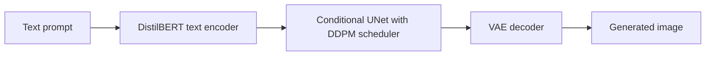

# Text-to-Image Latent Diffusion

A latent diffusion pipeline that generates images from text prompts, with each stage trained separately: an image autoencoder, a text encoder, and a conditional denoising UNet. A Flask API runs generation as background jobs.

The repo is named for the original goal of animated video, but the code currently covers text-to-image generation.

**Stack:** Python, PyTorch, Diffusers, Transformers, Accelerate, Albumentations, Flask

## How it works

1. **VAE:** compresses images into a small latent space, trained with a KL term, VGG perceptual loss and an adversarial loss from a discriminator.
2. **Text encoder:** DistilBERT trained with a CLIP-style contrastive loss to align text with image latents.
3. **Conditional UNet:** learns to denoise latents given the text embedding, using Diffusers' `UNet2DConditionModel` and `DDPMScheduler`.
4. **API:** runs sampling in a separate process and saves intermediate images as it goes, so a client can poll a job and watch the image form.

## Files

| File | Purpose |
|---|---|
| `vae.py` | VAE model and training |
| `descriminator.py` | Discriminator for the adversarial loss |
| `clip.py` | Text encoder and contrastive training |
| `condition_ldm.py` | `TextToImage` model, UNet training and inference |
| `dataset.py` | Data loading, augmentation and perceptual loss |
| `api.py` | Flask job API |

## API

| Endpoint | Purpose |
|---|---|
| `POST /text_to_image` | Starts a job from `prompt`, with optional `n_images`, `n_inf_steps` and `stream_freq`; returns a `job_id` |
| `GET /jobs/<job_id>/` | Returns the latest images and whether the job has finished |

## Current limitations

This is a code snapshot, and it won't run as cloned:

- **Module names:** the code imports `conditional_ldm`, `train_clip` and `discriminator`, but the files are named `condition_ldm.py`, `clip.py` and `descriminator.py`.
- **Missing files:** model checkpoints, the dataset and a dependency list aren't included. `dataset.py` expects CelebA images under `./archive/`.
- **Hardware:** `api.py` is hardcoded to Apple Silicon (`mps`).
